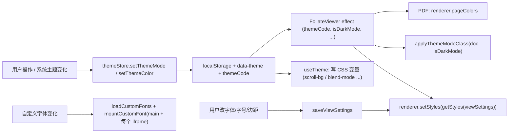
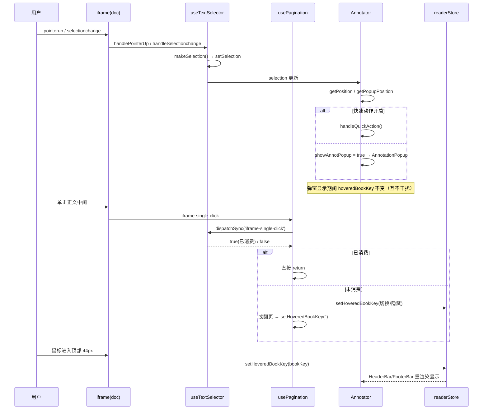

# MyReader 阅读器设计说明

本文说明阅读器（Reader）三个核心机制的设计与实现：

1. **基础控制流** —— 视图创建、打开文件、更新配置、关闭。
2. **样式控制** —— 主题（浅色/深色/电子墨水）差异与字体变更机制。
3. **阅读器与 Toolbar 的交互** —— 选中事件响应、工具栏显示/隐藏时机、点击仲裁。

> 约定：文中源码链接均为 `file:///` 绝对路径并带行号。行号基于当前代码，若后续重构请以符号名为准。

---

## 0. 总体分层

阅读器是"外壳 + 书正文"两层结构，这是理解后文所有样式与交互问题的前提：

| 层 | 宿主 | 负责 | 样式来源 |
| --- | --- | --- | --- |
| 外壳（UI 层） | 主文档 `document` | 工具栏、侧栏、弹窗、背景纹理 | `globals.css` + daisyUI 主题 |
| 书正文（内容层） | `<foliate-view>` 内部 iframe | EPUB/PDF 正文排版与渲染 | `getStyles()` 生成的样式串，经 `renderer.setStyles()` 注入 |

由于正文在 iframe 中渲染，主文档的 CSS **无法**跨 iframe 生效，因此正文样式必须走独立的注入通道。这是 `globals.css` 与 `getStyles()` 并存的原因。

```
Reader (路由壳)
└── ReaderContent (书列表 / 生命周期)
    ├── BooksGrid
    │   └── gridcell × N
    │       ├── FoliateViewer   →  <foliate-view> → iframe(正文)
    │       ├── HeaderBar       (顶部工具栏)
    │       ├── FooterBar       (底部工具栏 / 侧栏入口)
    │       └── Annotator       (选中、批注、弹窗)
    ├── Sidebar (TOC / 笔记)
    └── AnnotationPopup / DictionaryPopup / ...
```

关键文件：

- 路由入口：[page.tsx](file:///Volumes/data/projects/poxenstudio/myreader/app/src/app/reader/page.tsx)（Tauri）、[[ids].tsx](file:///Volumes/data/projects/poxenstudio/myreader/app/src/pages/reader/[ids].tsx)（Web 多书）
- 路由壳：[Reader.tsx](file:///Volumes/data/projects/poxenstudio/myreader/app/src/app/reader/components/Reader.tsx)
- 生命周期与书列表：[ReaderContent.tsx](file:///Volumes/data/projects/poxenstudio/myreader/app/src/app/reader/components/ReaderContent.tsx)
- 正文渲染：[FoliateViewer.tsx](file:///Volumes/data/projects/poxenstudio/myreader/app/src/app/reader/components/FoliateViewer.tsx)
- 状态中枢：[readerStore.ts](file:///Volumes/data/projects/poxenstudio/myreader/app/src/store/readerStore.ts)

---

## 1. 基础控制流

### 1.1 入口与挂载

- App Router 在 [layout.tsx#L8](file:///Volumes/data/projects/poxenstudio/myreader/app/src/app/layout.tsx#L8) 引入 `globals.css`；Pages Router 在 [_app.tsx#L6](file:///Volumes/data/projects/poxenstudio/myreader/app/src/pages/_app.tsx#L6) 引入。两条路由共享同一套全局样式。
- [Reader.tsx#L62-L63](file:///Volumes/data/projects/poxenstudio/myreader/app/src/app/reader/components/Reader.tsx#L62-L63) 获取 `useThemeStore`、`useDeviceControlStore`，在文章级别决定主题与系统 UI 可见性。
- [Reader.tsx#L131-L140](file:///Volumes/data/projects/poxenstudio/myreader/app/src/app/reader/components/Reader.tsx#L131-L140)：`systemUIVisible = !!hoveredBookKey || settings.alwaysShowStatusBar`，据此调用 `showSystemUI / dismissSystemUI` —— 工具栏状态会反向影响系统状态栏/导航栏的显示。

### 1.2 创建视图：`initViewState`

一个"书视图"（view）由 `bookKey` 唯一标识，核心逻辑在 [readerStore.ts#L189-L449](file:///Volumes/data/projects/poxenstudio/myreader/app/src/store/readerStore.ts#L189-L449)。

流程：

1. **读取书数据**：从 `useBookDataStore` 取 `bookData`（[L197-L198](file:///Volumes/data/projects/poxenstudio/myreader/app/src/store/readerStore.ts#L197-L198)）。
2. **先写占位状态**：写入 `loading` 状态的 `viewState`，让 UI 立刻有反馈（[L199-L219](file:///Volumes/data/projects/poxenstudio/myreader/app/src/store/readerStore.ts#L199-L219)）。
3. **并行加载配置**：`configPromise = appService.loadBookConfig(book, settings)`（[L239](file:///Volumes/data/projects/poxenstudio/myreader/app/src/store/readerStore.ts#L239)）。
4. **加载文件**（无缓存或 `reload` 时，[L248-L286](file:///Volumes/data/projects/poxenstudio/myreader/app/src/store/readerStore.ts#L248-L286)）：
   - PSE 流 → 流式文档加载器；
   - Feed 类 → Feed 加载器；
   - 普通文件 → `DocumentLoader(file, { nativeFilePath }).open()`。
5. **构造目录**：加载/计算 `TOC nav`（[L313-L335](file:///Volumes/data/projects/poxenstudio/myreader/app/src/store/readerStore.ts#L313-L335)）。
6. **落库**：把 `book / file / config / bookDoc / isFixedLayout` 写入 `booksData[id]`（[L392-L398](file:///Volumes/data/projects/poxenstudio/myreader/app/src/store/readerStore.ts#L392-L398)）。
7. **合并视图设置**：`viewSettings = { ...globalViewSettings, ...configViewSettings }`，并生成 `viewerKey = \`${key}-${uniqueId()}\``（[L399-L421](file:///Volumes/data/projects/poxenstudio/myreader/app/src/store/readerStore.ts#L399-L421)）。`viewerKey` 变化会强制 React 重挂载 `<FoliateViewer>`。
8. **失败兜底**：异常时写入 `error: 'Failed to load book.'`（[L423-L448](file:///Volumes/data/projects/poxenstudio/myreader/app/src/store/readerStore.ts#L423-L448)）。

调用点在 [ReaderContent.tsx#L78](file:///Volumes/data/projects/poxenstudio/myreader/app/src/app/reader/components/ReaderContent.tsx#L78)：

```ts
initViewState(envConfig, id, key, isPrimary).catch(...)
```

`recreateViewer`（[readerStore.ts#L655-L666](file:///Volumes/data/projects/poxenstudio/myreader/app/src/store/readerStore.ts#L655-L666)）只是以 `reload=true` 再次调用 `initViewState` 并更新 `viewerKey`，用于切换排版引擎等需要"整本书重载"的场景。

### 1.3 打开文件：`<foliate-view>` 的创建与 `open`

`initViewState` 只负责"拿到 `bookDoc` 并放到 store"，真正创建 DOM 与渲染发生在 [FoliateViewer.tsx](file:///Volumes/data/projects/poxenstudio/myreader/app/src/app/reader/components/FoliateViewer.tsx)：

1. 创建自定义元素并包装：[L670](file:///Volumes/data/projects/poxenstudio/myreader/app/src/app/reader/components/FoliateViewer.tsx#L670)

   ```ts
   const view = wrappedFoliateView(document.createElement('foliate-view'))
   ```

2. 打开书：[L692](file:///Volumes/data/projects/poxenstudio/myreader/app/src/app/reader/components/FoliateViewer.tsx#L692) `await view.open(bookDoc)`
3. 注入正文样式：[L732](file:///Volumes/data/projects/poxenstudio/myreader/app/src/app/reader/components/FoliateViewer.tsx#L732)

   ```ts
   view.renderer.setStyles?.(getStyles(viewSettings, undefined, getLoadedFonts()))
   ```

4. 应用页边距与栏间距：[L777](file:///Volumes/data/projects/poxenstudio/myreader/app/src/app/reader/components/FoliateViewer.tsx#L777) `applyMarginAndGap()`
5. 定位到上次阅读位置：[L792](file:///Volumes/data/projects/poxenstudio/myreader/app/src/app/reader/components/FoliateViewer.tsx#L792) `await view.init({ lastLocation })`

此外，每个 iframe 文档渲染完成后还会做三件事：

- 注入已加载的自定义字体：[L352](file:///Volumes/data/projects/poxenstudio/myreader/app/src/app/reader/components/FoliateViewer.tsx#L352) `getLoadedFonts().forEach(font => mountCustomFont(doc, font))`
- 应用图片样式：[L369](file:///Volumes/data/projects/poxenstudio/myreader/app/src/app/reader/components/FoliateViewer.tsx#L369) `applyImageStyle(detail.doc)`
- 标记主题模式类名：[L372](file:///Volumes/data/projects/poxenstudio/myreader/app/src/app/reader/components/FoliateViewer.tsx#L372) `applyThemeModeClass(detail.doc, isDarkMode)`

### 1.4 更新配置：`saveViewSettings`

所有阅读设置（字体、字号、边距、行距、主题色覆盖等）的更新都收敛到 [settings.ts#L32-L83](file:///Volumes/data/projects/poxenstudio/myreader/app/src/helpers/settings.ts#L32-L83) 的 `saveViewSettings(envConfig, bookKey, key, value, skipGlobal, applyStyles)`：

1. **去抖**：仅当 `viewSettings[key] !== value` 时才调用 `setViewSettings`（[L48-L50](file:///Volumes/data/projects/poxenstudio/myreader/app/src/helpers/settings.ts#L48-L50)）。
2. **立即重绘正文**：`applyStyles` 为真时执行
   `view?.renderer.setStyles?.(getStyles(viewSettings))`（[L51-L54](file:///Volumes/data/projects/poxenstudio/myreader/app/src/helpers/settings.ts#L51-L54)）。
   注意此处未显式传 `themeCode` 与自定义字体，`getStyles` 内部默认走 `getThemeCode()` 读当前主题，因此主题仍是正确的。
3. **持久化到本书**：primary view 时写入 `bookData.config.viewSettings`（[L56-L58](file:///Volumes/data/projects/poxenstudio/myreader/app/src/helpers/settings.ts#L56-L58)）。
4. **全局生效**：若该设置项属于 `isGlobal` 且未 `skipGlobal`，则构造新的 `settings.globalViewSettings`，遍历 `bookKeys` 全部应用并 `saveSettings`；否则只作用于当前书（[L62-L79](file:///Volumes/data/projects/poxenstudio/myreader/app/src/helpers/settings.ts#L62-L79)）。

`setViewSettings` 本身在 [readerStore.ts#L451-L481](file:///Volumes/data/projects/poxenstudio/myreader/app/src/store/readerStore.ts#L451-L481)，primary view 时同步写回 `bookData.config.viewSettings`。

> 设计要点：**配置更新 = 状态更新 + 立即重绘 + 持久化** 三步分离。UI 只调用 `saveViewSettings`，不直接触碰 `view.renderer`。

### 1.5 关闭

关闭分三层：

**a) 单本关闭（保存进度后清理）** —— [ReaderContent.tsx#L149-L166](file:///Volumes/data/projects/poxenstudio/myreader/app/src/app/reader/components/ReaderContent.tsx#L149-L166)

```ts
saveConfigAndCloseBook(bookKey, keepTTSAlive)
  → 保存阅读进度 / book config
  → clearViewState(bookKey)
```

`clearViewState`（[readerStore.ts#L174-L187](file:///Volumes/data/projects/poxenstudio/myreader/app/src/store/readerStore.ts#L174-L187)）清理 `viewStates` 与对应 `bookData`，React 随之卸载 `<FoliateViewer>`，iframe 与渲染资源一并释放。

**b) 批量关闭** —— [ReaderContent.tsx#L185-L203](file:///Volumes/data/projects/poxenstudio/myreader/app/src/app/reader/components/ReaderContent.tsx#L185-L203)

`handleCloseBooks`（throttle 包裹）遍历 `bookKeys` 逐个 `saveConfigAndCloseBook`；`handleCloseBooksToLibrary` 先 `handleCloseBooks(true)` 再返回书库（[L264](file:///Volumes/data/projects/poxenstudio/myreader/app/src/app/reader/components/ReaderContent.tsx#L264) `onGoToLibrary`）。

**c) 系统级关闭事件** —— [ReaderContent.tsx#L122-L132](file:///Volumes/data/projects/poxenstudio/myreader/app/src/app/reader/components/ReaderContent.tsx#L122-L132)

监听 `tauriHandleOnCloseWindow`、`beforeunload`、`beforereload`、`quit-app`，统一转成 `handleCloseBooks`，保证退出前进度落盘。

删除/移除某本书时也会先行 `saveConfigAndCloseBook(bookKey, true)`（[L222](file:///Volumes/data/projects/poxenstudio/myreader/app/src/app/reader/components/ReaderContent.tsx#L222)），避免丢失进度。

**d) Android 返回键的优先级** —— [Reader.tsx#L84-L101](file:///Volumes/data/projects/poxenstudio/myreader/app/src/app/reader/components/Reader.tsx#L84-L101)

```
Back(返回)
  ├─ hoveredBookKey 存在 → setHoveredBookKey(null)   // 先收工具栏
  ├─ 侧栏打开 → 关闭侧栏
  ├─ 笔记面板打开 → 关闭笔记
  └─ 否则 → eventDispatcher.dispatch('close-reader'); router.back()
```

### 1.6 控制流时序

```mermaid
sequenceDiagram
  participant UI as ReaderContent
  participant RS as readerStore
  participant DL as DocumentLoader
  participant FV as FoliateViewer
  participant RT as foliate renderer

  UI->>RS: initViewState(env, id, key, isPrimary)
  RS->>RS: 写 loading viewState
  RS->>DL: loadBookConfig(book) (并行)
  RS->>DL: open(file)  // PSE / Feed / 普通文件
  DL-->>RS: bookDoc + TOC
  RS->>RS: booksData[id] = {...}; viewSettings 合并; viewerKey++
  RS-->>UI: viewState 就绪 (viewerKey 变化触发重挂载)
  UI->>FV: 渲染 <FoliateViewer>
  FV->>FV: createElement('foliate-view')
  FV->>RT: view.open(bookDoc)
  FV->>RT: renderer.setStyles(getStyles(viewSettings))
  FV->>RT: applyMarginAndGap()
  FV->>RT: view.init({ lastLocation })
  Note over UI,RT: 用户改设置 → saveViewSettings → setStyles 即时重绘
  UI->>RS: saveConfigAndCloseBook → clearViewState
  RS-->>UI: 卸载 FoliateViewer，释放 iframe
```

---

## 2. 样式控制

### 2.1 两层样式体系

| 层 | 文件 | 作用范围 | 是否跨 iframe |
| --- | --- | --- | --- |
| 全局样式 | [globals.css](file:///Volumes/data/projects/poxenstudio/myreader/app/src/styles/globals.css) | 主文档（工具栏、弹窗、`foliate-view` 宿主尺寸、电子墨水 UI 覆盖） | 否 |
| 正文样式 | [style.ts](file:///Volumes/data/projects/poxenstudio/myreader/app/src/utils/style.ts) | iframe 内部（书正文） | 是（通过 `setStyles` 注入） |

`globals.css` 中例如 `.hover-bar-anim:hover ~ .foliate-viewer`（[L115](file:///Volumes/data/projects/poxenstudio/myreader/app/src/styles/globals.css#L115)）、`[data-eink='true']` 的整段 UI 覆盖（[L503-L688](file:///Volumes/data/projects/poxenstudio/myreader/app/src/styles/globals.css#L503-L688)）、`.no-transitions *`（[L748](file:///Volumes/data/projects/poxenstudio/myreader/app/src/styles/globals.css#L748)）都只影响外壳。

> 注意：`globals.css` 里存在的 `[data-page]` 相关规则当前**无代码设置该属性**，实际不生效，排查样式问题时不要被它误导。

正文样式串由 `getStyles(viewSettings, themeCode?, customFonts = [])` 生成（[style.ts#L846-L918](file:///Volumes/data/projects/poxenstudio/myreader/app/src/utils/style.ts#L846-L918)），拼接顺序：

```
@namespace epub
  + getPageLayoutStyles()        // 页边距 / zoom / writing-mode / 图片 / 链接热区
  + 段落布局 (paragraphLayout)    // useBookLayout 时为空，交给书自带排版
  + getFontStyles()              // 字体族 / 字号 / 字重
  + getColorStyles()             // 前景/背景/链接/图片/深色兼容
  + translation / warichu / ruby  // 翻译、割注、注音
  + getCustomFontFaces()          // @font-face（blobUrl）
  + userStylesheet                // 用户自定义 CSS
```

### 2.2 浅色与深色主题的特殊定义

主题不是简单的 `.dark` 类切换，而是 **CSS 变量 + 类名 + 样式串重写 + 图片处理** 四层配合。

**a) 主题变量写入（外壳）**

[themeStore.ts](file:///Volumes/data/projects/poxenstudio/myreader/app/src/store/themeStore.ts)：

- 默认模式 `'auto'`（[L47-L60](file:///Volumes/data/projects/poxenstudio/myreader/app/src/store/themeStore.ts#L47-L60)）；主题色在电子墨水下发默认为 `'contrast'`，否则 `'default'`。
- `systemIsDarkMode` 来自 `matchMedia('(prefers-color-scheme: dark)')`（[L65-L69](file:///Volumes/data/projects/poxenstudio/myreader/app/src/store/themeStore.ts#L65-L69)）。
- `setThemeMode` / `setThemeColor` 写 localStorage，设置 `data-theme="${themeColor}-${dark|light}"`，并刷新 `isDarkMode` 与 `themeCode`（[L87-L109](file:///Volumes/data/projects/poxenstudio/myreader/app/src/store/themeStore.ts#L87-L109)）。
- 系统主题变化时按当前 `themeMode` 重算并同步 `data-theme` / `themeCode`（[L135-L144](file:///Volumes/data/projects/poxenstudio/myreader/app/src/store/themeStore.ts#L135-L144)）。

[useTheme.ts#L130-L147](file:///Volumes/data/projects/poxenstudio/myreader/app/src/hooks/useTheme.ts#L130-L147) 进一步写入运行时变量：

| 变量 | 浅色 | 深色 | 电子墨水 |
| --- | --- | --- | --- |
| `--scroll-bg-opacity` | 0.5 | 0.5 | 1.0 |
| `--overlayer-highlight-opacity` | 由 `highlightOpacity` 决定 | 同左 | 同左 |
| `--overlayer-highlight-blend-mode` | `multiply` | `screen` | `difference` |
| `--bg-texture-blend-mode` | `multiply` | `lighten` | `lighten` |

主题调色板来自 [themes.ts](file:///Volumes/data/projects/poxenstudio/myreader/app/src/styles/themes.ts)，每个内置主题都带 `palette.light` / `palette.dark` 两套；自定义主题经 `applyCustomTheme` 注册（[useTheme.ts#L122-L128](file:///Volumes/data/projects/poxenstudio/myreader/app/src/hooks/useTheme.ts#L122-L128)）。

**b) 正文档位（`getColorStyles`）**

[style.ts#L219-L347](file:///Volumes/data/projects/poxenstudio/myreader/app/src/utils/style.ts#L219-L347) 显式区分深浅：

- 输出 `--theme-bg-color` / `--theme-fg-color` / `--theme-primary-color`，并设置 `color-scheme: dark|light`。
- `overrideColor` 且无背景纹理时，强制覆盖 `section / aside / blockquote / table / th / td` 的背景、前景、边框，避免书自带浅色硬编码在深色下刺眼。
- 链接 `a:any-link`：浅色用 primary，深色用 lightblue；电子墨水加下划线。
- **图片**：深色模式 `img { filter: invert(100%) }`；`overrideColor` 下叠加 `grayscale + contrast + brightness` 与 `mix-blend-mode: multiply`；内联图片用 `screen`（深色）/ `multiply`（浅色）。
- 深色下 `code` / `blockquote` / `table *` 用 `color-mix(in srgb, bg 90%/80%, #000)` 生成协调的背景色。
- 硬编码色文字（`font[color=...]`、`*[style*="color: ..."]`）强制改为 `--theme-fg-color`。
- 深色且未开 `overrideColor` 时追加 `getDarkModeLightBackgroundOverrides(bg)`。
- 附带 Gutenberg / Feedbooks / calibre 的兼容规则。

**c) 浅色背景重写（深色模式的关键兜底）**

[style.ts#L153-L204](file:///Volumes/data/projects/poxenstudio/myreader/app/src/utils/style.ts#L153-L204)：

- `isLightCssColor()`：用亮度阈值 **> 0.85** 判定"接近白色"的颜色。
- `getDarkModeLightBackgroundOverrides(bg)`：把书里所有浅色背景重写成主题深色背景，并追加
  `body.theme-dark { background-color: transparent !important; }`，让 iframe 透出外壳背景，避免出现"深色外壳 + 白色书页"的割裂。

**d) 主题模式类名**

`applyThemeModeClass(document, isDarkMode)`（[style.ts#L1136](file:///Volumes/data/projects/poxenstudio/myreader/app/src/utils/style.ts#L1136)）给 iframe 的 `body` 加 `theme-dark` / `theme-light`。上述 `body.theme-dark` 规则依赖它生效，因此**每次 iframe 重建或主题切换都必须重新调用**（[FoliateViewer.tsx#L372](file:///Volumes/data/projects/poxenstudio/myreader/app/src/app/reader/components/FoliateViewer.tsx#L372)、[L918](file:///Volumes/data/projects/poxenstudio/myreader/app/src/app/reader/components/FoliateViewer.tsx#L918)）。

**e) 样式串转换**

`transformStylesheet(css, vw, vh, vertical)`（[style.ts#L953](file:///Volumes/data/projects/poxenstudio/myreader/app/src/utils/style.ts#L953) 起）：

- 移动端字号放大系数 1.25；
- `px → rem`、`vw/vh → px`（按 iframe 实际尺寸换算）；
- 深色模式下再次重写浅色背景。

**f) PDF 特殊处理**

PDF 是 pre-paginated，不走上面的 CSS 重写，而是直接设置渲染器颜色（[FoliateViewer.tsx#L923-L929](file:///Volumes/data/projects/poxenstudio/myreader/app/src/app/reader/components/FoliateViewer.tsx#L923-L929)）：

```ts
renderer.pageColors = { background: themeCode.bg, foreground: themeCode.fg }
```

### 2.3 电子墨水（e-ink）的特殊样式

电子墨水不是"另一个主题"，而是叠加在浅/深色之上的**渲染约束**：

- [useEinkMode.ts](file:///Volumes/data/projects/poxenstudio/myreader/app/src/hooks/useEinkMode.ts) 检测 `window.__MYBOOKS_IS_EINK` / 系统设置，给 `documentElement` 加 `data-eink` 与 `no-transitions`（关闭过渡动画，避免残影）。
- [globals.css#L503-L688](file:///Volumes/data/projects/poxenstudio/myreader/app/src/styles/globals.css#L503-L688) 针对 `[data-eink='true']` 重定义阴影、文字色、边框、按钮、弹窗，统一为高对比、无阴影。
- `getEinkSelectionStyles()`（[style.ts#L206-L217](file:///Volumes/data/projects/poxenstudio/myreader/app/src/utils/style.ts#L206-L217)）：选中反色 `color: var(--theme-bg-color); background: var(--theme-fg-color)`。
- `getColorStyles` 中 `isEink` 时强制 `body { background-color: bg !important }`，并给链接加下划线，保证无颜色差异下仍可辨识。
- `--overlayer-highlight-blend-mode: difference`（[useTheme.ts](file:///Volumes/data/projects/poxenstudio/myreader/app/src/hooks/useTheme.ts#L130-L147)），让高亮在灰度屏上仍可见。

### 2.4 字体的变更机制

字体涉及两条独立链路：**内置/设置项字体** 与 **自定义字体文件**。

**a) 字体族与字号（样式串）**

[style.ts#L70-L150](file:///Volumes/data/projects/poxenstudio/myreader/app/src/utils/style.ts#L70-L150)：

- 输出 CSS 变量：`--serif` / `--sans-serif` / `--monospace` / `--font-size` / `--min-font-size` / `--font-weight`。
- `html, body { font-size: Npx !important; font-weight: ... }`。
- 默认 `html { font-family: var(--serif|--sans-serif) }`。
- `pre, code, kbd { font-family: var(--monospace) }` 保持等宽。
- 开启 `overrideFont` 时更强：`html body { font-family: ... !important }`，且
  `body *:not(pre, code, kbd, .code) { font-family: revert !important }` —— 先清空书内局部字体再用统一字体覆盖。
- `font[size=1..7]` 映射到具体字号。

**b) 自定义字体文件（@font-face + 注入）**

[fonts.ts](file:///Volumes/data/projects/poxenstudio/myreader/app/src/styles/fonts.ts)：

- `createFontCSS(font)`（[L216-L238](file:///Volumes/data/projects/poxenstudio/myreader/app/src/styles/fonts.ts#L216-L238)）生成 `@font-face { src: url(blobUrl) format(...); font-display: swap }`；可变字体省略 `style/weight`。
- `mountCustomFont(document, font)`（[L258-L266](file:///Volumes/data/projects/poxenstudio/myreader/app/src/styles/fonts.ts#L258-L266)）把 `<style id="custom-font-{id}">` 追加到 `document.head`。
- 因为 `@font-face` 也必须存在于 iframe 内，`getStyles` 会把已加载字体的 `@font-face` 内联进样式串（`getCustomFontFaces`，[style.ts#L926-L936](file:///Volumes/data/projects/poxenstudio/myreader/app/src/utils/style.ts#L926-L936)），同时 `FoliateViewer` 对每个 section doc 调用 `mountCustomFont`（[L352](file:///Volumes/data/projects/poxenstudio/myreader/app/src/app/reader/components/FoliateViewer.tsx#L352)）作为双保险。

**c) 字体变更的传播**

在 [FontPanel / FontLayoutPanel] 中选择字体 → 调用 `saveViewSettings` → `setStyles(getStyles(...))` 立即重绘。若新增/删除自定义字体，`settings.customFonts` 变化触发 [FoliateViewer.tsx#L960-L973](file:///Volumes/data/projects/poxenstudio/myreader/app/src/app/reader/components/FoliateViewer.tsx#L960-L973)：

```
loadCustomFonts(envConfig)
  → 主文档 mountCustomFont
  → 遍历所有 iframe doc mountCustomFont
```

### 2.5 主题 / 字体更新传播



对应 [FoliateViewer.tsx#L908-L942](file:///Volumes/data/projects/poxenstudio/myreader/app/src/app/reader/components/FoliateViewer.tsx#L908-L942)，effect 依赖 `themeCode, isDarkMode, scrolled, overrideColor, invertImgColorInDark, applyThemeToPDF, contrast, hideScrollbar`；insets/边距变化则单独调 `applyMarginAndGap()`（[L994](file:///Volumes/data/projects/poxenstudio/myreader/app/src/app/reader/components/FoliateViewer.tsx#L994)）。

---

## 3. 阅读器与 Toolbar 的交互

### 3.1 状态模型：单一开关 `hoveredBookKey`

工具栏显隐**不**使用各自的 boolean，而由 [readerStore.ts#L153-L156](file:///Volumes/data/projects/poxenstudio/myreader/app/src/store/readerStore.ts#L153-L156) 的 `hoveredBookKey` 统一表达：

```ts
hoveredBookKey: null,
setHoveredBookKey: (key) => set({ hoveredBookKey: key }),
```

- 值为某个 `bookKey` → 该书工具栏显示；
- 值为 `null` / `''` → 隐藏。

多书分屏时，同一时刻最多一本书的工具栏可见。顶部栏与底部栏各自比较 `hoveredBookKey === bookKey` 决定是否渲染。

### 3.2 工具栏组成与触发区

**顶部 HeaderBar** — [HeaderBar.tsx](file:///Volumes/data/projects/poxenstudio/myreader/app/src/app/reader/components/HeaderBar.tsx)

- 可见判定：`isHeaderVisible = hoveredBookKey === bookKey || isDropdownOpen`（[L145](file:///Volumes/data/projects/poxenstudio/myreader/app/src/app/reader/components/HeaderBar.tsx#L145)）。
- 顶部 **44px**（`h-11`）透明触发区（[L167-L170](file:///Volumes/data/projects/poxenstudio/myreader/app/src/app/reader/components/HeaderBar.tsx#L167-L170)），`onClick / onMouseEnter / onTouchStart → setHoveredBookKey(bookKey)`。
- 栏体高度 `h-11`（[L187](file:///Volumes/data/projects/poxenstudio/myreader/app/src/app/reader/components/HeaderBar.tsx#L187)）；多书时加 `hover-bar-anim` 类（[L192](file:///Volumes/data/projects/poxenstudio/myreader/app/src/app/reader/components/HeaderBar.tsx#L192)），配合 `globals.css` 的兄弟选择器实现推挤动画。
- `onMouseLeave` 与关闭按钮都置空：`setHoveredBookKey(null)`（[L201-L204](file:///Volumes/data/projects/poxenstudio/myreader/app/src/app/reader/components/HeaderBar.tsx#L201-L204)、[L321](file:///Volumes/data/projects/poxenstudio/myreader/app/src/app/reader/components/HeaderBar.tsx#L321)）。
- 下拉菜单关闭时也会强制隐藏：`if (!isOpen) setHoveredBookKey('')`（[L100](file:///Volumes/data/projects/poxenstudio/myreader/app/src/app/reader/components/HeaderBar.tsx#L100)）。

**底部 FooterBar** — [FooterBar.tsx](file:///Volumes/data/projects/poxenstudio/myreader/app/src/app/reader/components/footerbar/FooterBar.tsx)

- `isVisible = hoveredBookKey === bookKey`；`actionTab = 可见 ? bottomBarTab : ''`（[L43-L44](file:///Volumes/data/projects/poxenstudio/myreader/app/src/app/reader/components/footerbar/FooterBar.tsx#L43-L44)）。
- 底边 **52px**（`h-[52px]`）触发区（[L245-L255](file:///Volumes/data/projects/poxenstudio/myreader/app/src/app/reader/components/footerbar/FooterBar.tsx#L245-L255)），`onMouseEnter / onTouchStart` 显示。
- 容器过渡类（[L222-L237](file:///Volumes/data/projects/poxenstudio/myreader/app/src/app/reader/components/footerbar/FooterBar.tsx#L222-L237)）：
  `isVisible ? 'translate-y-0 opacity-100' : 'pointer-events-none translate-y-full opacity-0'`；桌面 `sm:translate-y-0` 常驻位移动画。
- `onFocus` 显示、`onMouseLeave`（宽度 ≥640）隐藏（[L264-L265](file:///Volumes/data/projects/poxenstudio/myreader/app/src/app/reader/components/footerbar/FooterBar.tsx#L264-L265)）。
- 点击 TOC / 笔记时先隐藏工具栏再打开侧栏：`setHoveredBookKey('')`（[L101-L137](file:///Volumes/data/projects/poxenstudio/myreader/app/src/app/reader/components/footerbar/FooterBar.tsx#L101-L137)）。
- Back / Escape 关闭：`setHoveredBookKey('')` + blur（[L160-L178](file:///Volumes/data/projects/poxenstudio/myreader/app/src/app/reader/components/footerbar/FooterBar.tsx#L160-L178)）；Android 下工具栏存在时拦截系统 Back（[L180-L195](file:///Volumes/data/projects/poxenstudio/myreader/app/src/app/reader/components/footerbar/FooterBar.tsx#L180-L195)）。

### 3.3 显示时机汇总

| 触发 | 位置 | 行为 |
| --- | --- | --- |
| 鼠标移入顶部 44px 区 | HeaderBar L167-170 | 显示 |
| 鼠标移入底部 52px 区 | FooterBar L245-255 | 显示 |
| 触摸顶部/底部触发区 | 同上 `onTouchStart` | 显示（移动端 hover 不生效，用 touch 兜底） |
| 点击正文中间区域 | usePagination L263-267 | 切换（显示 ↔ 隐藏） |
| 键盘 Tab 聚焦工具栏 | HeaderBar L201 / FooterBar L264 | 显示 |
| 下拉菜单展开 | HeaderBar L145 | 保持显示 |

### 3.4 隐藏时机汇总

| 触发 | 位置 | 行为 |
| --- | --- | --- |
| 鼠标离开工具栏/触发区 | HeaderBar L201-204 / FooterBar L264-265 | 隐藏 |
| 翻页（点击侧边、滑动、键盘、硬件键） | usePagination L329 / L393 | 隐藏 |
| 点击 TOC / 笔记入口 | FooterBar L101-137 | 先隐藏再开侧栏 |
| Back / Escape | FooterBar L160-178 / Reader L84-101 | 隐藏 |
| 点击下拉菜单关闭 | HeaderBar L100 | 隐藏 |
| 点击正文空白/选中区 | usePagination L269-272 | 隐藏（且不翻页） |

### 3.5 选中事件响应

正文在 iframe 内，选中事件必须由 iframe 的 Document 代理回主线程。链路：

**a) 事件注册** — [Annotator.tsx#L398-L425](file:///Volumes/data/projects/poxenstudio/myreader/app/src/app/reader/components/annotator/Annotator.tsx#L398-L425)

对每个 section doc 注册 `touchmove`、`pointerup`、`selectionchange`，回调绑定 `(doc, index)`，以便把 iframe 内选区换算成 CFI。

**b) 选择器处理** — [useTextSelector.ts](file:///Volumes/data/projects/poxenstudio/myreader/app/src/app/reader/hooks/useTextSelector.ts)

- `handlePointerUp(doc, index, ev)`（[L463](file:///Volumes/data/projects/poxenstudio/myreader/app/src/app/reader/hooks/useTextSelector.ts#L463)）：鼠标/触摸抬起的最终确认。
- `handleSelectionchange(doc, index)`（[L568](file:///Volumes/data/projects/poxenstudio/myreader/app/src/app/reader/hooks/useTextSelector.ts#L568)）：选区变化；iOS 拖动选择柄时会被延迟到手势结束再处理，避免弹窗闪烁。
- `makeSelection()`：读取 `selection.toString()`、`view.getCFI(index, range)`、当前页码，组装成 `TextSelection` 并 `setSelection`。
- `handleShowPopup(showPopup)`（[L656-L663](file:///Volumes/data/projects/poxenstudio/myreader/app/src/app/reader/hooks/useTextSelector.ts#L656-L663)）用 500ms 防抖维护 `isPopuped`，供点击仲裁使用。

**c) 弹窗定位与展示** — [Annotator.tsx#L949-L1013](file:///Volumes/data/projects/poxenstudio/myreader/app/src/app/reader/components/annotator/Annotator.tsx#L949-L1013)

`selection` 变化的 effect 中：

1. `setHighlightOptionsVisible(!!(selection && selection.annotated))`；
2. `getPosition` + `getPopupPosition` 计算弹窗锚点（位置为 0 则直接 return，避免在不可见区域弹窗）；
3. Word Lens 开启 → 走 `handleDictionary()`；
4. `enableAnnotationQuickActions && annotationQuickAction && isTextSelected.current` → `handleQuickAction()`（快速动作，[L900-L947](file:///Volumes/data/projects/poxenstudio/myreader/app/src/app/reader/components/annotator/Annotator.tsx#L900-L947)）；
5. 否则 `handleShowAnnotPopup()`（[L1076](file:///Volumes/data/projects/poxenstudio/myreader/app/src/app/reader/components/annotator/Annotator.tsx#L1076)）→ `showAnnotPopup = true` → 渲染 `AnnotationPopup`（[L1863](file:///Volumes/data/projects/poxenstudio/myreader/app/src/app/reader/components/annotator/Annotator.tsx#L1863)）。

**d) 触摸特殊处理**

- `handleTouchMove`（[L340](file:///Volumes/data/projects/poxenstudio/myreader/app/src/app/reader/components/annotator/Annotator.tsx#L340)、[L383](file:///Volumes/data/projects/poxenstudio/myreader/app/src/app/reader/components/annotator/Annotator.tsx#L383)）：手指移动即隐藏弹窗，避免拖动选择时弹窗跟随抖动。
- 快速动作的 `quickActionMinHoldMs = 300`（[L898](file:///Volumes/data/projects/poxenstudio/myreader/app/src/app/reader/components/annotator/Annotator.tsx#L898)）：Android 上长按选中先于 `touchend`，动作延后到 `touchend` 执行，避免弹窗在手指按下时就弹出。
- `dismissAllPopups` / `handleDismissPopupAndSelection`（[L196-L290](file:///Volumes/data/projects/poxenstudio/myreader/app/src/app/reader/components/annotator/Annotator.tsx#L196-L290)）统一复位所有弹窗与选择状态，组件卸载时也会清理监听（[L372-L436](file:///Volumes/data/projects/poxenstudio/myreader/app/src/app/reader/components/annotator/Annotator.tsx#L372-L436)）。

### 3.6 点击仲裁：点击到底该做什么

一次正文点击可能同时命中多个意图：取消选中、关闭弹窗、切换工具栏、翻页。仲裁采用**同步事件管道**：

[usePagination.ts#L226-L292](file:///Volumes/data/projects/poxenstudio/myreader/app/src/app/reader/hooks/usePagination.ts#L226-L292)

```ts
const consumed = eventDispatcher.dispatchSync('iframe-single-click');
if (consumed) return;                     // 被选中/弹窗消费，不再翻页或切工具栏
```

消费方是 [useTextSelector.ts#L682-L710](file:///Volumes/data/projects/poxenstudio/myreader/app/src/app/reader/hooks/useTextSelector.ts#L682-L710) 的 `handleSingleClick`，按优先级判断：

| 顺序 | 条件 | 行为 | 是否消费 |
| --- | --- | --- | --- |
| 1 | `isUpToPopup` | 触发了弹窗 | 是 |
| 2 | `isTextSelected` | 取消选择 + `deselect()` | 是 |
| 3 | `isPopuped` | 关闭弹窗 | 是 |
| 4 | 其余 | 交给翻页 / 工具栏逻辑 | 否 |

未被消费时，`usePagination` 继续：

1. 中间 **37.5%–62.5%** 区域判定（[L253-L255](file:///Volumes/data/projects/poxenstudio/myreader/app/src/app/reader/hooks/usePagination.ts#L253-L255)）；
2. 图片/表格且 `disableClick || inCenter` → `iframe-open-media`（[L259-L262](file:///Volumes/data/projects/poxenstudio/myreader/app/src/app/reader/hooks/usePagination.ts#L259-L262)）；
3. `disableClick || inCenter` → 切换 `hoveredBookKey ? null : bookKey`（[L263-L267](file:///Volumes/data/projects/poxenstudio/myreader/app/src/app/reader/hooks/usePagination.ts#L263-L267)）；
4. 工具栏已显示时点侧边 → 只隐藏、不翻页（[L269-L272](file:///Volumes/data/projects/poxenstudio/myreader/app/src/app/reader/hooks/usePagination.ts#L269-L272)）；
5. 其余按 `fullscreenClickArea / swapClickArea` 翻页，阅读尺模式优先（[L274-L291](file:///Volumes/data/projects/poxenstudio/myreader/app/src/app/reader/hooks/usePagination.ts#L274-L291)）。

> 这就是"选中优先于工具栏、工具栏优先于翻页"的实现方式：用**同步**派发而非异步事件，保证同一次点击内结论唯一。

### 3.7 交互时序



### 3.8 与系统 UI 的联动

`Reader.tsx` 在 `hoveredBookKey` 变化时重新计算 `systemUIVisible`（[L131-L140](file:///Volumes/data/projects/poxenstudio/myreader/app/src/app/reader/components/Reader.tsx#L131-L140)），把工具栏状态映射为原生状态栏/导航栏的显隐。因此在移动端，工具栏收起的同时系统 UI 也一并隐藏，进入沉浸阅读。

---

## 4. 单独启动一个阅读器进行调试

日常开发不需要完整走"书库 → 导入 → 打开"的流程，可以直接用 URL 命中阅读器路由，只加载一本书。前提是该书已经在本机书库中（本地 IndexedDB / Tauri 的 `library.json`），因为 `initViewState` 是通过 `getBookByHash()` 从书库反查书数据的（[useOpenWithBooks.ts#L148-L154](file:///Volumes/data/projects/poxenstudio/myreader/app/src/hooks/useOpenWithBooks.ts#L148-L154)）。

### 4.1 两种运行形态

| 形态 | 启动命令 | 平台标志 | 阅读器路由 |
| --- | --- | --- | --- |
| 纯 Web（最快，无需 Rust） | `pnpm dev-web` | `NEXT_PUBLIC_APP_PLATFORM=web`（[.env.web](file:///Volumes/data/projects/poxenstudio/myreader/app/.env.web)） | Pages Router [/reader/[ids].tsx](file:///Volumes/data/projects/poxenstudio/myreader/app/src/pages/reader/[ids].tsx) |
| Tauri 桌面壳 | `pnpm tauri dev` | `NEXT_PUBLIC_APP_PLATFORM=tauri`（[.env.tauri](file:///Volumes/data/projects/poxenstudio/myreader/app/.env.tauri)） | App Router [/reader/page.tsx](file:///Volumes/data/projects/poxenstudio/myreader/app/src/app/reader/page.tsx) + `?ids=` |
| 移动端（带 devtools） | `pnpm dev-android` / `pnpm dev-ios` | tauri | 同 Tauri |
| 自动化（WebDriver） | `pnpm tauri:dev:test` | tauri + `webdriver` feature | 同 Tauri |

说明：

- `pnpm dev` 只启动 Next dev server（端口固定在 `3000`，见 [tauri.conf.json#L8-L10](file:///Volumes/data/projects/poxenstudio/myreader/app/src-tauri/tauri.conf.json#L8-L10) 的 `devUrl` 与 `beforeDevCommand`），**不会**打开桌面窗口；桌面调试要用 `pnpm tauri dev`（它会自动先跑 `pnpm dev`）。
- `pnpm dev-web` 走 `.env.web`，不编译 Rust，改前端代码的热更新最快，适合调样式、Toolbar、选中弹窗。
- 移动端命令带 `--features devtools`，可在真机上打开 WebView 检查器。

### 4.2 拿到 bookHash

`bookKey` 的格式是 `${bookHash}-${7位随机后缀}`，[getBookHash](file:///Volumes/data/projects/poxenstudio/myreader/app/src/utils/book.ts#L58-L67) 负责剥掉后缀，所以 URL 里只写 hash 即可。

获取方式任选：

1. 在书库中点击一本书，观察地址栏（Web）或 devtools 的 `location.href`（Tauri）；
2. 打开开发者工具，在控制台查看 `Initialize books` 日志（[ReaderContent.tsx#L72](file:///Volumes/data/projects/poxenstudio/myreader/app/src/app/reader/components/ReaderContent.tsx#L72)），其中打印了完整的 `bookKeys`；
3. 直接查本地书库数据，取 `book.hash`。

### 4.3 用 URL 只加载一本书

**Web**

```
http://localhost:3000/reader/<bookHash>
```

多本书用 `+` 分隔（`BOOK_IDS_SEPARATOR`，见 [constants.ts#L819](file:///Volumes/data/projects/poxenstudio/myreader/app/src/services/constants.ts#L819)）：

```
http://localhost:3000/reader/<hash1>+<hash2>
```

**Tauri / 通用**

```
/reader?ids=<bookHash>
```

也可以带 `cfi` 直接定位到某个位置（由 `navigateToReader(..., queryParams)` 透传，[nav.ts#L95-L109](file:///Volumes/data/projects/poxenstudio/myreader/app/src/utils/nav.ts#L95-L109)）：

```
/reader?ids=<bookHash>&cfi=epubcfi(/6/14!/4/2/2)
```

在 Tauri 里没有地址栏，可在 devtools 控制台执行：

```js
location.href = '/reader?ids=<bookHash>';
```

路由参数解析逻辑在 [ReaderContent.tsx#L62-L70](file:///Volumes/data/projects/poxenstudio/myreader/app/src/app/reader/components/ReaderContent.tsx#L62-L70)：依次取 `props.ids` → `?ids=` → 路径 `/reader/` 之后的部分，再按 `+` 拆分。

### 4.4 调试单本书的注意事项

1. **初始化只执行一次**：`ReaderContent` 的 init effect 由 `isInitiating` ref + 空依赖守卫（[L62-L64](file:///Volumes/data/projects/poxenstudio/myreader/app/src/app/reader/components/ReaderContent.tsx#L62-L64)）。在 SPA 内把 `/reader/A` 改成 `/reader/B` **不会**重新初始化，必须整页刷新。刷新会触发 `beforereload` → `handleCloseBooks` 保存进度（[L122-L132](file:///Volumes/data/projects/poxenstudio/myreader/app/src/app/reader/components/ReaderContent.tsx#L122-L132)），因此不会丢进度。
2. **改 `initViewState` 要看整页行为**：HMR 只会重跑 React 渲染，不会重放 store 的初始化流程；改完请手动刷新。
3. **单书最小依赖**：`Reader` 需等 `libraryLoaded && settings.globalReadSettings` 就绪才渲染（[Reader.tsx#L144](file:///Volumes/data/projects/poxenstudio/myreader/app/src/app/reader/components/Reader.tsx#L144)）。一直白屏说明书库或设置没加载完，先看控制台有没有初始化日志。
4. **嵌入部署才有的门禁**：`ReaderAccessGuard` 仅在 `isWebAppPlatform() && isLocalDbDisabled()` 时请求 `/api/mybooks/whoami`（[ReaderAccessGuard.tsx#L33](file:///Volumes/data/projects/poxenstudio/myreader/app/src/app/reader/components/ReaderAccessGuard.tsx#L33)），本地 `dev-web` 不会触发，无需登录。

### 4.5 常用观测点

| 想确认 | 位置 |
| --- | --- |
| 书是否被解析、bookKey 是否正确 | [ReaderContent.tsx#L62-L90](file:///Volumes/data/projects/poxenstudio/myreader/app/src/app/reader/components/ReaderContent.tsx#L62-L90) 的 `console.log('Initialize books', ...)` |
| 加载失败原因 | [readerStore.ts#L423-L448](file:///Volumes/data/projects/poxenstudio/myreader/app/src/store/readerStore.ts#L423-L448) 写入的 `error`，以及 `Error initializing book` 日志 |
| 正文样式是否正确注入 | 在 `FoliateViewer` 的 [L732](file:///Volumes/data/projects/poxenstudio/myreader/app/src/app/reader/components/FoliateViewer.tsx#L732) 打断点，观察 `getStyles(viewSettings)` 的返回值 |
| iframe 内选区/样式 | devtools 的元素选择器切到 iframe 上下文；或控制台用 `view.renderer.getContents()` 取 `doc` |
| 求值/重绘是否触发 | [FoliateViewer.tsx#L908-L942](file:///Volumes/data/projects/poxenstudio/myreader/app/src/app/reader/components/FoliateViewer.tsx#L908-L942) 的样式 effect、[L994](file:///Volumes/data/projects/poxenstudio/myreader/app/src/app/reader/components/FoliateViewer.tsx#L994) 的 `applyMarginAndGap()` |
| 工具栏为何显示/隐藏 | 控制台读 `hoveredBookKey`，显隐完全由它驱动（本文章节 3） |

### 4.6 单测与 E2E

```bash
pnpm test -- src/__tests__/utils/style.test.ts   # 单个单测文件（vitest + jsdom）
pnpm test:browser                                 # 浏览器环境测试（Chromium）
pnpm test:e2e:web                                 # Playwright E2E
pnpm test:e2e:web:headed                          # 有头模式，便于观察
```

- `getStyles` 的纯函数特性使其很适合做快照/单测，无需启动阅读器。
- 需要真实 iframe、选区、滚动行为的用例走 `test:browser` 或 Playwright。
- Tauri 侧交互回归用 `pnpm tauri:dev:test` + `pnpm test:tauri`。

### 4.7 常见问题

| 现象 | 原因 | 处理 |
| --- | --- | --- |
| toast「Unable to open book」 | hash 不在本地书库 | 先打开 `/library` 导入该书 |
| 一直白屏、无报错 | `libraryLoaded` / `globalReadSettings` 未就绪 | 看控制台初始化日志，确认书库加载完成 |
| 改 URL 后书没变 | 初始化 effect 只跑一次 | 整页刷新 |
| 多个 hash 打不开 | 分隔符用错 | 用 `+`，不是 `,` |
| `pnpm dev` 没有桌面窗口 | 它只是 Next dev server | 用 `pnpm tauri dev` |
| 改端口后 Tauri 打不开 | `devUrl` 写死 3000 | 同步修改 [tauri.conf.json#L9](file:///Volumes/data/projects/poxenstudio/myreader/app/src-tauri/tauri.conf.json#L9) |

---

## 5. 关键文件索引

| 主题 | 文件 | 关键位置 |
| --- | --- | --- |
| 路由壳 / Back 优先级 | [Reader.tsx](file:///Volumes/data/projects/poxenstudio/myreader/app/src/app/reader/components/Reader.tsx) | L84-101, L131-140 |
| 生命周期 / 关闭 | [ReaderContent.tsx](file:///Volumes/data/projects/poxenstudio/myreader/app/src/app/reader/components/ReaderContent.tsx) | L78, L122-132, L149-166, L185-203 |
| 状态中枢 | [readerStore.ts](file:///Volumes/data/projects/poxenstudio/myreader/app/src/store/readerStore.ts) | L153-156, L174-187, L189-449, L451-481, L655-666 |
| 配置更新 | [settings.ts](file:///Volumes/data/projects/poxenstudio/myreader/app/src/helpers/settings.ts) | L32-83 |
| 正文渲染 / 样式注入 | [FoliateViewer.tsx](file:///Volumes/data/projects/poxenstudio/myreader/app/src/app/reader/components/FoliateViewer.tsx) | L670, L692, L732, L777, L792, L908-942, L960-973, L994 |
| 正文样式生成 | [style.ts](file:///Volumes/data/projects/poxenstudio/myreader/app/src/utils/style.ts) | L70-150, L153-204, L206-217, L219-347, L349-431, L846-918, L953+, L1136 |
| 主题状态 | [themeStore.ts](file:///Volumes/data/projects/poxenstudio/myreader/app/src/store/themeStore.ts) | L47-60, L87-109, L135-144 |
| 主题变量 | [useTheme.ts](file:///Volumes/data/projects/poxenstudio/myreader/app/src/hooks/useTheme.ts) | L122-147 |
| 主题调色板 | [themes.ts](file:///Volumes/data/projects/poxenstudio/myreader/app/src/styles/themes.ts) | palette.light / palette.dark |
| 自定义字体 | [fonts.ts](file:///Volumes/data/projects/poxenstudio/myreader/app/src/styles/fonts.ts) | L216-238, L258-266 |
| 电子墨水 | [useEinkMode.ts](file:///Volumes/data/projects/poxenstudio/myreader/app/src/hooks/useEinkMode.ts) | 全文 |
| 全局样式 | [globals.css](file:///Volumes/data/projects/poxenstudio/myreader/app/src/styles/globals.css) | L115, L503-688, L748 |
| 顶部工具栏 | [HeaderBar.tsx](file:///Volumes/data/projects/poxenstudio/myreader/app/src/app/reader/components/HeaderBar.tsx) | L145, L167-170, L187-204, L321 |
| 底部工具栏 | [FooterBar.tsx](file:///Volumes/data/projects/poxenstudio/myreader/app/src/app/reader/components/footerbar/FooterBar.tsx) | L43-44, L101-137, L160-195, L222-265 |
| 点击仲裁 | [usePagination.ts](file:///Volumes/data/projects/poxenstudio/myreader/app/src/app/reader/hooks/usePagination.ts) | L226-292, L329, L393 |
| 选中处理 | [useTextSelector.ts](file:///Volumes/data/projects/poxenstudio/myreader/app/src/app/reader/hooks/useTextSelector.ts) | L463, L568, L656-663, L682-710 |
| 选区弹窗 | [Annotator.tsx](file:///Volumes/data/projects/poxenstudio/myreader/app/src/app/reader/components/annotator/Annotator.tsx) | L398-425, L949-1013, L1076, L1863 |
| 启动脚本 | [package.json](file:///Volumes/data/projects/poxenstudio/myreader/app/package.json) | L8-45（`dev` / `dev-web` / `tauri dev` / `dev-android`） |
| 桌面开发配置 | [tauri.conf.json](file:///Volumes/data/projects/poxenstudio/myreader/app/src-tauri/tauri.conf.json) | L8-10（`frontendDist` / `devUrl` / `beforeDevCommand`） |
| 路由与 bookHash | [nav.ts](file:///Volumes/data/projects/poxenstudio/myreader/app/src/utils/nav.ts) · [book.ts](file:///Volumes/data/projects/poxenstudio/myreader/app/src/utils/book.ts) | nav L95-109；book L58-67 |
